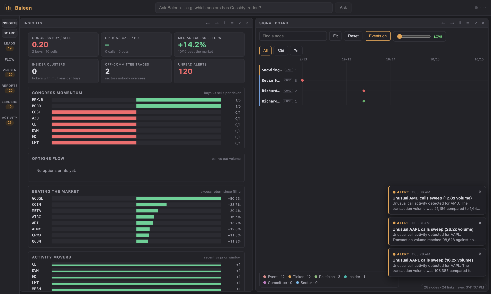

<p align="center">
  
</p>

<h1 align="center">Baleen</h1>

<p align="center">Congressional trades, insider filings and unusual options flow in one queryable graph.</p>

<p align="center">
  <a href="https://github.com/Faycall1l/Baleen/actions/workflows/ci.yml"></a>
  <a href="LICENSE"></a>
</p>



Baleen polls public disclosure feeds, extracts typed trade events, and writes them to a Neo4j graph where every node links back to its source filing. A React workspace on top surfaces ranked leads, KPIs and charts, and answers plain-English questions with the Cypher it ran.

## Features

- **Live data, no API keys.** House Clerk periodic transaction reports (PDF parsing), a Senate disclosure mirror, SEC EDGAR Form 4 insider filings, and delayed CBOE option chains. The X API is an optional extra source.
- **Insights.** Buy/sell ratio, call/put ratio, median excess return, insider clusters and off-committee trades, with charts for congress momentum, options flow, market-beating filings and activity movers.
- **Story leads.** Ranked signals computed from the graph, with no model involved: trades in sectors a member's committees do not oversee, filings that beat the market, congress buying momentum, insider cluster buys.
- **Signal board and flow tape.** Time-aligned event lanes with a scrubber, plus a filterable tape of options and insider prints.
- **Ask the graph.** A natural-language question becomes Cypher, is checked against an allowlist, runs on a read-only Neo4j role, and comes back as a table with source links. With no matching data it says so.
- **Alerts and reports.** Three rules (oversight-sector trades, $1M+ insider buys, options volume 5x open interest), a brief per event and a daily digest.
- **Leaderboard, path finder, detail cards.** Trades ranked by return since filing, the shortest connection between two entities, and cards for politicians, tickers and committees.
- **Shareable views.** Layout, selection and filters live in the URL.

## Quickstart

```bash
cp .env.example .env
docker compose up --build
docker compose exec backend python -m scripts.seed_reference
```

UI at http://localhost:5173, API docs at http://localhost:8000/docs. The scheduler polls every five minutes. Free-text extraction and brief drafting need an OpenAI-compatible LLM (`LLM_BASE_URL`); structured filings skip the model, so the keyless feeds work without one. To run without any LLM or credentials, use the bundled mock and sample corpus described in [docs/SETUP.md](docs/SETUP.md).

## How it works

```
sources ─► Postgres raw records ─► extraction ─► Neo4j ─► alerts · reports · signals · query agent ─► REST/SSE ─► React
```

- **Idempotent.** Raw records dedup on a unique id; graph writes use `MERGE` on natural keys, so re-running any stage changes nothing.
- **Grounded extraction.** Filing rows become events directly. Free text goes through LLM tool-calling against Pydantic schemas, and low-confidence output is stored as `UnparsedEvent` instead of being force-fit.
- **Traceable.** Every node and edge carries its source URL.
- **Guarded query agent.** Generated Cypher must pass a label and relationship allowlist and contain no write clause or procedure call.
- **Isolated sources.** One failing feed never blocks the others, and failures back off rather than retry hot.

## Development

```bash
# backend: needs Postgres and Neo4j (docker compose up -d postgres neo4j)
cd backend && pip install -r requirements-dev.txt && pytest -q
ruff check . && ruff format --check .

# frontend
cd frontend && npm ci && npm run dev    # API on :8000
npm test && npm run build
```

CI runs both suites against Postgres and Neo4j service containers.

## Layout

```
backend/app/   ingestion · extraction · graph · query · alerts · reports · signals · api
backend/tests/ unit and integration tests
frontend/src/  components · hooks · tileState.ts (split-tree layout model)
docs/          ARCHITECTURE · SCHEMA · SETUP · ALERTS
```

[Architecture](docs/ARCHITECTURE.md) · [Graph and table schema](docs/SCHEMA.md) · [Setup and configuration](docs/SETUP.md) · [Alert rules](docs/ALERTS.md)

## Disclaimer

Informational only, not financial advice. Not affiliated with X Corp. or any data provider.
