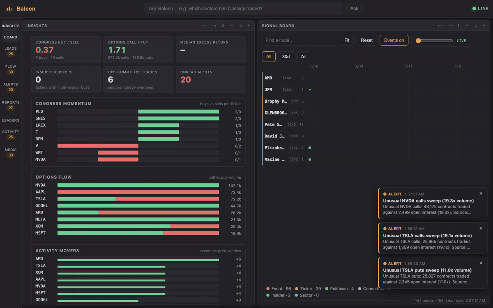
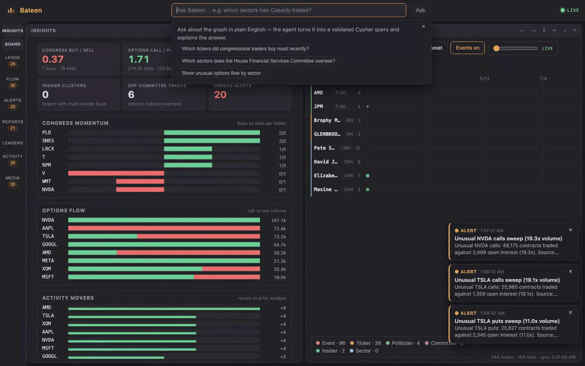
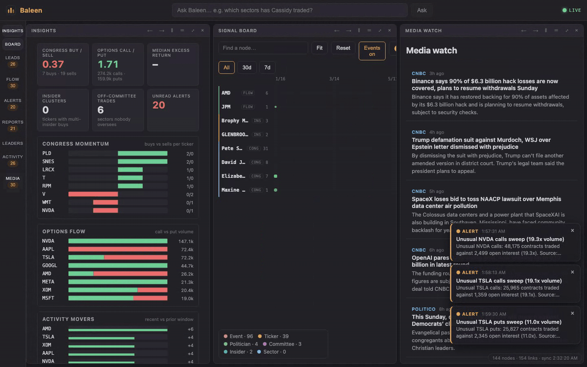
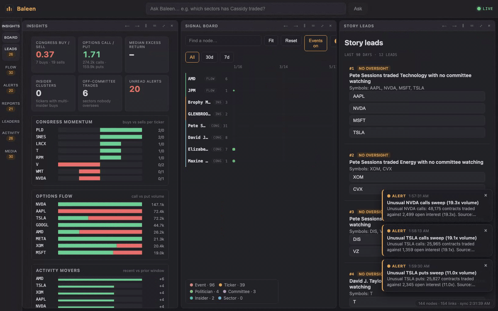

# Five-minute demo

For reviewers who want to see the system working without reading the code.

## Run it

```bash
cp .env.example .env
docker compose up --build -d
docker compose exec backend python -m scripts.seed_reference
docker compose exec backend python -m scripts.ingest_once --real
```

`--real` pulls the live keyless feeds once (House Clerk PTRs, the Senate
mirror, SEC Form 4 filings, delayed CBOE chains and the news feeds), runs the full pipeline and
writes the graph. No API key is needed. Open <http://localhost:5173>; the API
docs are at <http://localhost:8000/docs>.

If you also have an OpenAI-compatible LLM configured (`LLM_BASE_URL`), the
free-text paths and brief prose are enabled. Without one, structured filings
still become events, options flow included; only free text stays pending.

## What to look at



1. **The board.** Events sit on time-aligned lanes, one row per ticker. Use the
   zoom presets and the scrubber to move the window; the URL updates so a view
   can be shared. Each dot opens the inspector.
2. **Detail cards.** Click any dot or search result. The card shows the entity,
   its relationships, and the source link for the underlying record. Split a
   tile with the split buttons in its title bar to compare two views.
3. **Path finder.** Select a node, choose *Path from here*, then pick a second
   node. The shortest connection is listed hop by hop, with the relationship on
   each edge.
4. **Ask the graph.** Try:

   

   - *Which tickers did congressional traders buy most recently?*
   - *What sectors does the House Financial Services Committee oversee, and
     which of those sectors have tickers in the graph?*
   - *Show unusual options flow in the last 24 hours by sector.*
   - *Which insiders bought more than $1M?*

   Every answer shows the Cypher it ran. If the graph has no matching data, it
   says so instead of inventing an answer.
5. **Alerts and reports.** The three watch rules fire per event; reports hold a
   brief per event plus a rolling daily digest, each with source links.
6. **Activity.** A digest of what moved in the window: biggest movers, new
   entities, and fresh events. It answers a different question from the ranked
   leads, which score relationships and oversight conflicts.
7. **Media watch.** Headlines from the keyless RSS/Atom monitor (SEC, Federal
   Reserve, CNBC, Politico). Articles stay visible even when no trade event is
   extracted; cashtags and roster names become chips that open the inspector.

   

Story leads (ranked from the graph with no model involved) sit in the
**Leads** tab:



## Prove it is live

Tail the backend log and wait for the next scheduler tick (every five minutes):

```bash
docker compose logs -f backend
```

A tick logs the ingest, extraction and write counts. Fresh filings appear on
the board without a refresh, and alerts arrive over SSE. To run one tick by
hand instead of waiting:

```bash
docker compose exec backend python -m scripts.ingest_once --real
```

## Re-record the GIFs

With the stack running and data ingested:

```bash
cd frontend
npx playwright install chromium   # once
node scripts/record-demo.mjs                      # all scenes
node scripts/record-demo.mjs http://localhost:5173 ask media   # some scenes
```

Each scene is scripted in Playwright (1440×900, dark theme, first-run tour
skipped), recorded to WebM, trimmed past page load and converted to a
palette-optimized GIF in `docs/media/` with ffmpeg.

## What this is not

Delayed market data, a hand-curated reference roster, and no formal
text-to-Cypher benchmark. See [RESEARCH.md](RESEARCH.md#evaluation-status) for
the honest limits.
